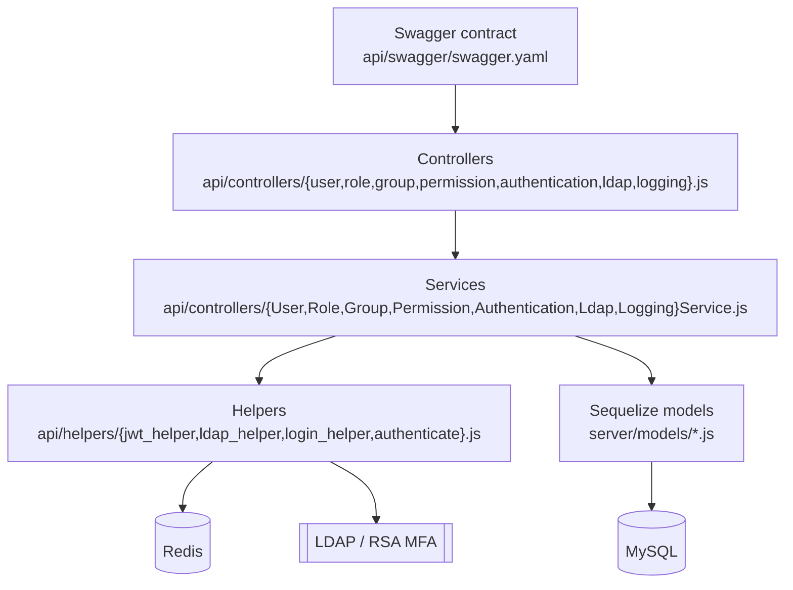
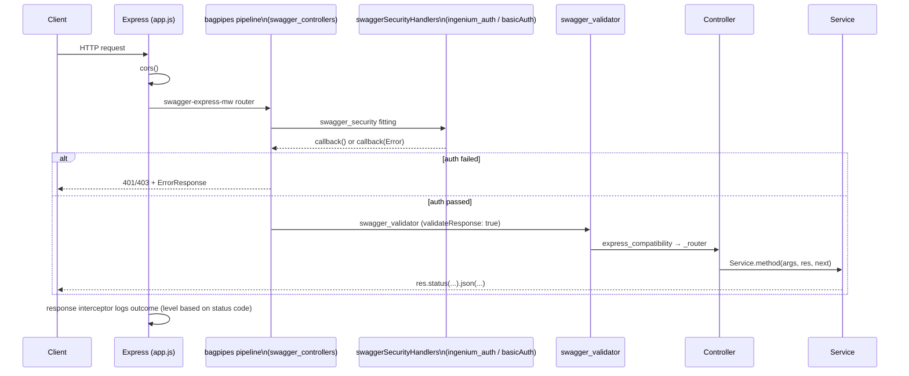
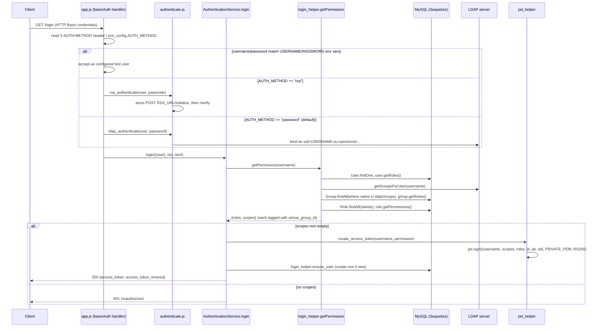
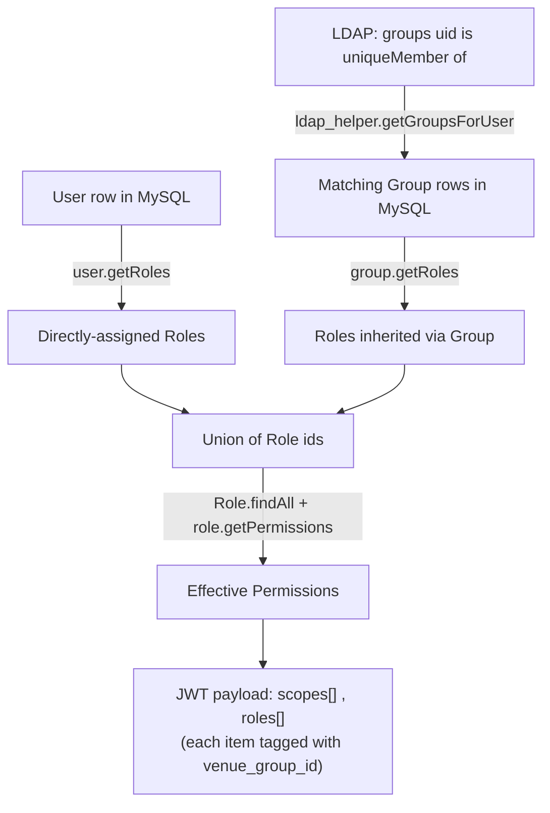

# Architecture

[← Back to Home](./README.md)

## Repository structure

```
auth-service/
├── auth_service/                  # The application (this is the Docker build context)
│   ├── app.js                     # Express bootstrap, security handlers, DB init
│   ├── env_config.js              # Central environment-variable reader
│   ├── node_funcs.js               # Winston logger + JWT username parsing + String.format
│   ├── redis.js                    # Redis client (token blacklist store)
│   ├── config/default.yaml         # swagger-node / bagpipes pipeline configuration
│   ├── api/
│   │   ├── swagger/swagger.yaml    # OpenAPI 2.0 contract — source of truth for routes
│   │   ├── controllers/            # Thin route delegators + the *Service business logic
│   │   └── helpers/                # authenticate.js, jwt_helper.js, ldap_helper.js, login_helper.js
│   ├── server/
│   │   ├── models/                 # Sequelize model definitions + index.js loader/bootstrapper
│   │   ├── migrations/             # Umzug/Sequelize migrations (schema + seed data)
│   │   ├── migrate.js              # CLI + programmatic migration runner (used by app.js at boot)
│   │   └── config.json             # Sequelize CLI DB connection config (dev/test/production)
│   ├── scripts/patch-bagpipes.js   # postinstall patch for the bagpipes dependency (Node 12+ compat)
│   ├── tests/                      # Jest unit tests + shared mocks (see Development & Testing)
│   ├── Dockerfile                  # Production image build
│   └── package.json                # npm scripts, dependencies, engines
├── .github/workflows/ci.yml         # GitHub Actions CI (tests + Docker build)
└── README.md                        # Public-facing quickstart
```

**No orchestration files are checked in.** There is no `docker-compose.yml`, `Makefile`, or `apache/` directory in this repository — MySQL and Redis must be provisioned and made reachable independently (e.g. standalone Docker containers), as documented in the root [README's Prerequisites](../README.md#prerequisites). `auth_service/redis.js` connects to a hard-coded hostname (`auth_service_redis`, port `6379`, no environment-variable override), so that hostname must resolve to a reachable Redis instance.

## Layered design

The codebase follows a straightforward layered pattern. Every layer only talks to the layer directly below it:



- **Controllers** (`api/controllers/user.js`, `role.js`, `group.js`, `permission.js`, `authentication.js`, `ldap.js`, `logging.js`) are pure delegators. Each handler pulls `req.swagger.params` (or, for auth routes, `req.params`/the JWT) and forwards it unchanged to the matching `*Service` function, `(args, res, next)`. This is verified directly by `auth_service/tests/unit/controllers_delegators.test.js`.
- **Services** (`UserService.js`, `RoleService.js`, `GroupService.js`, `PermissionService.js`, `AuthenticationService.js`, `LdapService.js`, `LoggingService.js` — all in `api/controllers/`) contain all business logic: query building, Sequelize calls, response shaping, and status-code decisions.
- **Helpers** (`api/helpers/`) encapsulate cross-cutting concerns: LDAP/RSA authentication, JWT issuance/verification, and RBAC permission resolution.
- **Models** (`server/models/`) define the Sequelize schema and associations described in [Core Components](./Core-Components.md#data-model--rbac-servermodels).

See [Core Components](./Core-Components.md) for what each file is responsible for, and [API Reference](./Api-Reference.md) for the full controller ↔ service ↔ route mapping.

## Request lifecycle

Every incoming HTTP request passes through the same pipeline, defined by `auth_service/app.js` and the bagpipes configuration in `auth_service/config/default.yaml`:



Key details (from `auth_service/config/default.yaml` `swagger_controllers` pipe and `auth_service/app.js`):

1. `cors` — CORS is enabled globally (`app.use(cors())`, plus a bagpipes `cors` fitting in the pipe).
2. `swagger_security` — runs the security handler(s) declared for the matched operation in `swagger.yaml` (`ingenium_auth` and/or `basicAuth`, defined inline in `app.js`).
3. `_swagger_validate` — validates the request **and** response bodies against the schemas in `swagger.yaml` (`validateResponse: true`).
4. `express_compatibility` → `_router` (`swagger_router`, `mockMode: false`) — dispatches to the controller module named by each path's `x-swagger-router-controller`.
5. **Response logging interceptor** (`express-interceptor` in `app.js`) — after the controller responds, it extracts the username from the JWT (or from `req.params.user` for Basic-Auth routes), builds a structured log entry `{user_name, service: 'auth_service', event: <operationId>}`, and logs it via `node_funcs.log` at `error` (status `< 200` or `>= 400`) or `info` otherwise.

## Login and token issuance flow



Full detail on each step lives in [Core Components → Authentication & Authorization](./Core-Components.md#authentication--authorization-helpers-apihelpers) and [Security & Error Handling](./Security-And-Error-Handling.md).

## RBAC resolution: how a user's effective permissions are computed

`login_helper.getPermission` (`auth_service/api/helpers/login_helper.js`) is the single function that turns a username into the `scopes`/`roles` that get embedded in the JWT. It combines **two independent sources**:



Important, code-verified details:

- **Group membership is resolved live against LDAP on every login** (`ldap_helper.getGroupsForUser`), not from the `UserGroup` join table in MySQL. The `UserGroup` and `UserPermission` Sequelize associations exist (`server/models/user.js`) and `UserPermission` rows are even seeded by `server/migrations/20170519012826-test_account.js`, but `getPermission` never queries them — see [Core Components](./Core-Components.md#data-model--rbac-servermodels) for the full note.
- Each role/permission is paired with the owning role's `venue_group_id` (added by `server/migrations/20240930000000-venuegroup.js`), so the JWT can carry venue-scoped as well as global grants.
- `AuthenticationService.login` treats an **empty `scopes` array as unauthorized** (`401`), even if LDAP authentication itself succeeded — a user must have at least one Role (direct or via Group) with at least one Permission to get a token.

## Cross-references

- [Core Components](./Core-Components.md) — per-file responsibilities for every layer shown above.
- [API Reference](./Api-Reference.md) — the concrete routes this pipeline serves.
- [Security & Error Handling](./Security-And-Error-Handling.md) — token verification, blacklisting, and error conventions.
- [Configuration](./Configuration.md) — every environment variable referenced above (`AUTH_METHOD`, `PUBLIC_PEM`, `PRIVATE_PEM`, `LDAP_URL`, `RSA_URL`, ...).
