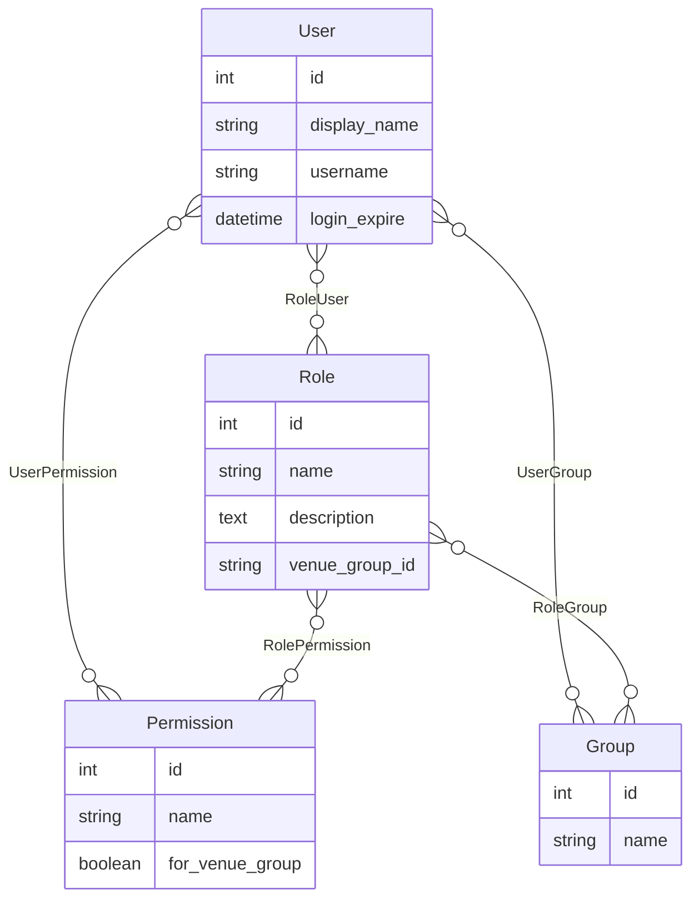

# Core Components

[← Back to Home](./README.md) · [Architecture](./Architecture.md) · [API Reference](./Api-Reference.md)

## Bootstrap: `auth_service/app.js`

Responsibilities, in order of execution:

1. Loads `env_config.js`, sets `global.LogLevel = env_config.DEBUG` (note: `env_config.DEBUG` is not defined by `env_config.js`, so this is `undefined` at runtime — see [Extending & Troubleshooting](./Extending-And-Troubleshooting.md)).
2. `app.use(cors())` and `app.options('*', cors())` — CORS enabled for all routes.
3. Registers an `express-interceptor` that logs every completed request (see [Architecture → Request lifecycle](./Architecture.md#request-lifecycle)).
4. Kicks off `index.init_db(10)` (from `server/models/index.js`) asynchronously — retries connecting/migrating the database up to 10 times, 5 seconds apart (`sleepSeconds`), logging an error if it never succeeds.
5. Defines `config.swaggerSecurityHandlers`, the two named security handlers referenced from `swagger.yaml`'s `securityDefinitions`:
   - **`ingenium_auth`** — verifies a Bearer JWT (`jwt.verify(token, PUBLIC_PEM, {algorithms: ['RS256']})`), checks the token's `jti` against the Redis blacklist (`jwtHelper.is_token_blacklisted`), and checks that the decoded `scopes` intersect with the scopes required by the matched operation (`_.intersection(scope_names, scopesOrApiKey)`).
   - **`basicAuth`** — parses `Authorization: Basic ...` via the `basic-auth` package, then either matches the configured test user (`env_config.test_user`/`test_pass`, i.e. `USERNAME`/`PASSWORD` env vars) or delegates to `authenticate.js`'s `rsa_authenticate` or `ldap_authenticate` depending on `env_config.AUTH_METHOD` (overridable per-request via the `X-AUTH-METHOD` header).
6. Calls `SwaggerExpress.create({appRoot: __dirname, swaggerSecurityHandlers}, ...)`, mounts `swagger-tools`'s Swagger UI, registers the swagger middleware on the Express app, and defines a plain `GET /` route (`"This is the auth-Z piece!!"`).
7. Starts listening on `process.env.PORT || env_config.PORT` (default `8080`) unless the module is being required by something else (`if (!module.parent)`), and exports the `app` instance either way — this is what lets Jest/supertest-style tests `require('../../app.js')` without starting a listener.

## Swagger / bagpipes pipeline: `auth_service/config/default.yaml`

`swagger-express-mw` is driven by `apigee-127/bagpipes`. `config/default.yaml` defines one pipe, `swagger_controllers`, used for every operation:

```yaml
swagger_controllers:
  - onError: json_error_handler
  - cors
  - swagger_security
  - _swagger_validate       # swagger_validator, validateResponse: true
  - express_compatibility
  - _router                 # swagger_router, controllersDirs: [api/controllers]
```

Two configuration details are worth flagging because they reference paths that **do not exist** in this repository:

- `fittingsDirs: [ api/fittings ]` — no `api/fittings` directory exists; bagpipes falls back to its built-in fittings (`cors`, `swagger_security`, `swagger_validator`, etc.), all of which are used above.
- `mockControllersDirs: [ api/mocks ]` with `mockMode: false` — mocking is disabled, so the (also non-existent) `api/mocks` directory is never consulted. `jest.config.js` also explicitly excludes `!api/mocks/**` from coverage, consistent with this being inactive.

## Controllers: `auth_service/api/controllers/*.js` (delegators)

Each controller file matches an `x-swagger-router-controller` value in `swagger.yaml` and exports one function per `operationId`. Every handler has the same shape — extract `req.swagger.params` and forward to the like-named `*Service` export:

| Controller | Delegates to | Operations |
|---|---|---|
| `user.js` | `UserService.js` | `get_all_users`, `get_user` |
| `role.js` | `RoleService.js` | `add_role_group`, `add_role_user`, `create_role`, `delete_role`, `delete_role_group`, `delete_role_permission`, `delete_role_user`, `edit_role`, `edit_role_groups`, `edit_role_permissions`, `edit_role_users`, `get_all_roles`, `get_role`, `get_role_groups`, `get_role_permissions`, `get_role_users` |
| `group.js` | `GroupService.js` | `get_all_groups`, `get_group`, `delete_group` |
| `permission.js` | `PermissionService.js` | `get_all_permissions`, `get_groups_for_permission`, `get_permission`, `get_users_for_permission` |
| `authentication.js` | `AuthenticationService.js` | `login` (forwards `req.params`), `logout`/`refresh_token` (forward the Bearer token extracted via `jwt_helper.get_jwt_from_header(req)`) |
| `ldap.js` | `LdapService.js` | `search_users`, `search_groups` |
| `logging.js` | `LoggingService.js` | `health`, `loglevelGET`, `loglevelPOST` |

This delegation contract is directly asserted by `auth_service/tests/unit/controllers_delegators.test.js`, which mocks each `*Service` and checks it is called with the exact `(params, res, next)` (or JWT string) the controller received.

**Observed gap:** `RoleService.add_role_group`, `RoleService.add_role_user`, and `GroupService.delete_group` are implemented, delegated-to by `role.js`/`group.js`, and covered by unit tests — but **no path in `swagger.yaml` maps to any of their `operationId`s** (`/roles/{role_id}/groups` and `/roles/{role_id}/users` only define `get`/`put`, not `post`; `/groups/{group_id}` only defines `get`, not `delete`). These functions are therefore unreachable from the public API in the current contract. See [Extending & Troubleshooting](./Extending-And-Troubleshooting.md).

## Services: business logic (`api/controllers/*Service.js`)

### `UserService.js`
- `get_all_users(args, res, next)` — builds a dynamic Sequelize query from query params (`limit`, `offset`, `order`, `q` prefix-match on `username`, `loggedin`). Three mutually-independent filters short-circuit the default query and instead compute the result set in memory: `rolefilter` (users belonging to roles matching a prefix), `scopefilter` (users belonging to roles that grant a matching permission), `groupfilter` (users belonging to groups matching a prefix). All three still apply order/offset/limit after loading.
- `get_user(args, res, next)` — `User.findById`, then expands to the full representation.
- `get_user_full(user)` *(exported)* — shared by every service that returns a user: attaches `loggedin` (`"Yes"`/`"No"` based on `login_expire` vs. now), `scopes` (permission names via the user's roles), `roles`, and `groups`; strips the internal `RoleUser` join attribute and `login_expire`.

### `RoleService.js` (largest service — the RBAC management surface)
- `create_role` / `edit_role` — validate the requested `users`/`groups` against LDAP (`validate_users_and_groups`, which special-cases the configured test user so it's never rejected), resolve/create the `Permission` rows for requested ids, then `role.setUsers/setPermissions/setGroups` inside a `Promise.join`.
- `add_role_group` / `add_role_user` — validate a single group/user against LDAP, `findOrCreate` it in MySQL, and attach it to the role. *(Not currently exposed via `swagger.yaml` — see above.)*
- `delete_role`, `delete_role_group`, `delete_role_permission`, `delete_role_user` — straightforward find-then-remove/destroy operations with 404 handling when the parent or child entity is missing.
- `edit_role_groups` / `edit_role_users` — replace a role's entire group/user set with a new LDAP-validated list (`role.setGroups`/`setUsers`), returning the resulting associated entities.
- `edit_role_permissions` — replace a role's permission set with permissions matched by id; returns `404` if any requested id doesn't resolve to a real `Permission`.
- `get_all_roles` — supports `name` prefix filter, `venue_group_id` exact filter, `offset`/`limit`/`order`.
- `get_role`, `get_role_groups`, `get_role_permissions`, `get_role_users` — read-only expansions of a single role's associations.
- Internal helpers (not exported except `get_scopes_and_roles`): `validate_users_and_groups`, `make_role`, `get_permissions`, `get_scopes_and_roles`/`get_scopes`/`get_roles` (these compute a **group's** effective scopes/roles the same way `UserService.get_user_full` does for users, and are reused by `GroupService` and `PermissionService`).
- **Known dead branch:** in `edit_role_groups`, the "invalid groups" error path references an undefined variable `invalid_groups` (should be `desired_groups` minus `valid_groups`), which would throw a `ReferenceError` if ever hit. `jest.config.js` explicitly carves out a lower coverage threshold for this file (`branches/functions: 100`, `statements/lines: 99`) with a comment noting this is intentionally preserved rather than "fixed" — see [Extending & Troubleshooting](./Extending-And-Troubleshooting.md).

### `GroupService.js`
- `get_all_groups` — same `limit`/`offset`/`order`/`q` pattern as `UserService`, plus `rolefilter`, `userfilter`, `scopefilter` (each computed in memory and expanded via `RoleService.get_scopes_and_roles`).
- `get_group` — single group with scopes/roles attached.
- `delete_group` — destroys a group by id.

### `PermissionService.js`
- `get_all_permissions` — flat list of `{id, name, for_venue_group}`.
- `get_permission` — single permission by id.
- `get_groups_for_permission` / `get_users_for_permission` — walk `permission.getRoles()` → each role's `getGroups()`/`getUsers()`, de-duplicate, then expand via `RoleService.get_scopes_and_roles` / `UserService.get_user_full`.

### `AuthenticationService.js`
- `login(args, res, next)` — see [Architecture → Login flow](./Architecture.md#login-and-token-issuance-flow). Calls `login_helper.getPermission`, and only issues a token if `permission.scopes.length > 0`; also calls `login_helper.ensure_user` (fire-and-forget, not awaited before responding) to create the user's DB row on first login.
- `logout(token, res, next)` — decodes the token (no signature re-verification here, just `jwt_helper.decode_jwt`), writes the token's `jti` into Redis with an expiry equal to `ACCESS_TOKEN_TIMEOUT`, and rewinds the user's `login_expire` via `jwt_helper.updateLoggedInStatus(username, true)`.
- `refresh_token(token, res, next)` — see below (`jwt_helper.refresh_token`).

### `LdapService.js`
Thin pass-through to `ldap_helper.search_users`/`search_groups`, used for autocomplete-style lookups (`GET /ldap/users`, `GET /ldap/groups`).

### `LoggingService.js`
- `health` — always `200 {"message": "ok"}`; declared with `security: []` in `swagger.yaml` (no auth required).
- `loglevelGET` — returns `global.LogLevel`.
- `loglevelPOST` — validates `args.data.value.loglevel` against `['ERROR','WARNING','INFO','DEBUG','TRACE']` and sets `global.LogLevel`. **Note:** this only mutates the `global.LogLevel` variable; it does not call `winston`'s `log.level` setter, so it does not actually change the verbosity of `node_funcs.log` (which is fixed at process start from `process.env.LOG_LEVEL`, default `debug`). The practical effect of `loglevelPOST` beyond changing the value returned by `loglevelGET` is not evidenced in the code.

## Authentication & authorization helpers (`api/helpers/`)

### `authenticate.js`
- `ldap_authenticate(username, password)` — binds to LDAP as `uid=<username>,ou=personnel,<env_config.ldap_base_dn>` using `env_config.ldap_url` and `env_config.ldap_tls_options`; resolves `false` on `InvalidCredentialsError` or any other bind error, `true`/result on success.
- `rsa_authenticate(username, passcode)` — two-step SecurID flow against `env_config.RSA_URL`: `POST /initialize` (gets an `authnAttemptId`), then `POST /verify` with the passcode; returns `true` only if `attemptResponseCode === 'SUCCESS'`.

### `jwt_helper.js`
- `encode_token(username, permission, jti, oit)` *(internal)* — signs `{username, scopes, roles, jti, iat, oit}` with `PRIVATE_PEM`, algorithm `RS256`, `expiresIn: ACCESS_TOKEN_TIMEOUT` (`'3410s'`, i.e. ~56.8 minutes). `iat` is backdated by `TEN_SEC_OFFSET` (10s) to tolerate clock skew; `oit` ("original issued time", seconds since epoch) is preserved across refreshes so `long_expire` can be measured from the *first* issuance, not the latest refresh.
- `decode_jwt(token)` — `jwt.verify` with `PUBLIC_PEM`/`RS256`; returns `null` (and logs) on any failure.
- `create_access_token(username, permission)` — bumps `login_expire` (`updateLoggedInStatus`), mints a fresh `jti` (`uuid.v4()`), and signs a new token.
- `refresh_token(access_token)` — decodes the token; if `(now − oit) < env_config.long_expire` (default `43200`s = 12h) **and** the `jti` is not already blacklisted (`existsAsync`), mints a new token that **reuses the same `jti` and `oit`**. If the 12-hour window has elapsed, returns `{access_token: "error"}`.
- `get_jwt_from_header(req)` — extracts the token from `Authorization: Bearer <token>`.
- `is_token_blacklisted(jti)` — `redisClient.getAsync(jti)`; truthy reply ⇒ blacklisted.
- `updateLoggedInStatus(username, logout)` — writes a formatted `login_expire` timestamp (now, or now+1h unless it's `logout`) onto the `Users` row. This is what the `/users` `loggedin` field and `loggedin` query filter are based on.

### `ldap_helper.js`
All functions open a fresh `ldapjs` client per call (`create_client`, promisified via `bluebird`) against `ldap_url`/`ou=personnel,<env_config.ldap_base_dn>`, and always `client.destroy()` when done:
- `validate_ldap_group_exists(name)` / `validate_ldap_groups_exist(names)` — existence checks against `objectclass=<env_config.ldap_group_objectclass>`.
- `validate_user_exists(name)` / `validate_users_exist(names)` — existence checks against `objectclass=person`.
- `getGroupsForUser(username)` — intersects the user's LDAP `uniqueMember` groups with groups **already known to the auth DB** (`models.Group.findAll`) — i.e., it will never surface a group Ingenium hasn't seen before.
- `get_user_info(username)` / `search_users(prefix)` / `search_groups(prefix)` — return `{username, displayName}` / group `cn` lists for autocomplete and user-provisioning.

### `login_helper.js`
- `getPermission(username)` — the RBAC resolution function; see [Architecture → RBAC resolution](./Architecture.md#rbac-resolution-how-a-users-effective-permissions-are-computed).
- `ensure_user(username)` — creates a `User` row (with `display_name` from LDAP) if one doesn't already exist; called after successful login.
- `ensure_users(usernames)` / `ensure_groups(groupnames)` — bulk `findOrCreate` helpers used by `RoleService` when attaching users/groups to a role.

## Data model & RBAC (`server/models/`)

`server/models/index.js` dynamically `require`s every `*.js` file in its own directory (except itself) as a Sequelize model, wires up each model's `associate(models)` if defined, then exposes the whole `db` object (plus `sequelize`, `Sequelize`, and `init_db`). It also:

- Opens a `Sequelize` connection to `env_config.db_host`/`db_name` and, in an async IIFE, best-effort `CREATE DATABASE auth` on a connection with no database selected (swallows the error if it already exists).
- `init_db(count)` — polls up to `count` times (5s apart) until `information_schema.tables` shows rows for the `auth` schema; if none are found, runs `migrate.cmdHardReset()` (drop all schemas) then `migrate.cmdMigrate()` (run all migrations) to bootstrap from scratch; otherwise just runs any newly-added migrations. This is what `app.js` calls at process start with `count = 10`.
- Calls `sequelize.sync()` with `force` commented out — i.e., it will create any tables Sequelize doesn't find, but will not drop/recreate existing ones.

### Entities and associations



- `User` ↔ `Role` (`RoleUser`), `User` ↔ `Group` (`UserGroup`), `User` ↔ `Permission` (`UserPermission`), `Role` ↔ `Permission` (`RolePermission`), `Role` ↔ `Group` (`RoleGroup`) — all defined in `server/models/{user,role,group,permission}.js` via `belongsToMany`.
- `venue_group_id` (on `Role`) and `for_venue_group` (on `Permission`) were added later by `server/migrations/20240930000000-venuegroup.js`. They let a Role/Permission be scoped to a particular "venue group" rather than being global; `login_helper.getPermission` tags every resolved role/permission with its role's `venue_group_id`.

**Observed but unused association — documented for accuracy, not speculation:** `User` ↔ `Group` (`UserGroup`) and `User` ↔ `Permission` (`UserPermission`) are defined as Sequelize associations, and `server/migrations/20170519012826-test_account.js` even seeds `UserPermissions` rows directly for the seeded test user. However, a repository-wide search shows **no service or helper ever queries `models.UserGroup` or `models.UserPermission`, and no code ever calls `.getPermissions()`/`.getGroups()` on a `User` instance directly** — `login_helper.getPermission` and `UserService`'s scope-resolution both go exclusively through the user's **Roles** (direct, or inherited via LDAP-resolved Groups). The practical effect of the seeded `UserPermissions` rows and the rationale for keeping this association are not documented in the repository.

### Migrations (`server/migrations/`)

Chronological migrations create the join tables and base tables (`20170215*`), then seed data: default `Permissions` (`20170221201539`), the `ingenium-dev` Group + `Admin` Role (`20170519012825`), the configured test account + `test-role` (`20170519012826`), `RolePermissions` for Admin/test-role (`20170607154708`), a `RoleGroups` link for Admin ↔ `ingenium-dev` (`20170607164120`), and finally the `venue_group_id`/`for_venue_group` columns (`20240930000000`). `server/migrate.js` wraps Umzug with CLI subcommands (`status`, `up`/`migrate`, `down`/`reset`, `next`/`migrate-next`, `prev`/`reset-prev`, `reset-hard`) — see [Development & Testing](./Development-And-Testing.md#database-migrations-servermigratejs).

## Cross-references

- [Architecture](./Architecture.md) — how these components fit into the request/login lifecycle.
- [API Reference](./Api-Reference.md) — the full route table these services implement.
- [Configuration](./Configuration.md) — every environment variable named above.
- [Security & Error Handling](./Security-And-Error-Handling.md) — the security handlers and error conventions in detail.
