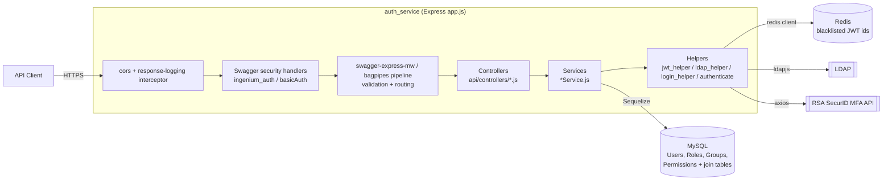

# Ingenium Auth Service — DeepWiki

Technical knowledge base for the `auth-service` repository. This is the companion to the top-level [`README.md`](../README.md): the README tells you *how to get started*, this wiki explains *how the system actually works* so you can develop, debug, and extend it with confidence.

> **Source of truth.** Everything in this wiki is derived from the code, configuration, and tests in this repository as of the current commit. Where the repository does not document a design decision or behavior, that is called out explicitly instead of being guessed at.

## What this service does

The auth service is a Node.js/Express API (generated with `swagger-express-mw` from `auth_service/api/swagger/swagger.yaml`) that implements **role-based access control (RBAC)** for the Ingenium platform:

- Authenticates users against **LDAP** (or an **RSA SecurID** MFA endpoint, or a configured local test account).
- Issues **RS256-signed JWTs** encoding a user's scopes (permissions) and roles.
- Stores **Users, Roles, Groups, and Permissions** (and their many-to-many relationships) in **MySQL** via **Sequelize**.
- Blacklists logged-out/expired tokens in **Redis** so they cannot be replayed.
- Exposes CRUD/management endpoints for roles, groups, permissions, and users, all protected by the JWTs it issues.

## Wiki map

| Page | Read this to understand... |
|---|---|
| [Architecture](./Architecture.md) | Repository layout, component responsibilities, request lifecycle, login/RBAC data flow, diagrams |
| [Core Components](./Core-Components.md) | Deep dive into `app.js`, the controller/service pattern, helpers, and the Sequelize models |
| [API Reference](./Api-Reference.md) | Every route in `swagger.yaml`, its controller/service mapping, and required scopes |
| [Configuration](./Configuration.md) | Every environment variable, config file, and how defaults/precedence work |
| [Development & Testing](./Development-And-Testing.md) | Local setup, Docker Compose, database migrations, Jest suite, coverage rules |
| [CI/CD & Deployment](./Ci-Cd-And-Deployment.md) | GitHub Actions workflow, Docker build, Compose topology |
| [Security & Error Handling](./Security-And-Error-Handling.md) | AuthN/AuthZ mechanisms, secrets handling, logging, and error-response conventions |
| [Extending & Troubleshooting](./Extending-And-Troubleshooting.md) | How to safely add endpoints/services/migrations/tests; known gaps and pitfalls |

## Technology stack (observed)

| Concern | Technology | Where |
|---|---|---|
| HTTP framework | Express 4 | `auth_service/app.js` |
| API contract / routing | Swagger 2.0 via `swagger-express-mw` + `bagpipes` pipeline | `auth_service/api/swagger/swagger.yaml`, `auth_service/config/default.yaml` |
| ORM / database | Sequelize 3.x over MySQL (`mysql` driver) | `auth_service/server/models`, `auth_service/server/migrate.js` |
| Migrations | Umzug 2.x (Sequelize storage) | `auth_service/server/migrate.js`, `auth_service/server/migrations/` |
| Session/blacklist store | Redis (`redis` v2 client + bluebird promisification) | `auth_service/redis.js` |
| AuthN | `ldapjs` (LDAP bind), `axios` (RSA SecurID MFA), `basic-auth` (HTTP Basic) | `auth_service/api/helpers/authenticate.js` |
| AuthZ / tokens | `jsonwebtoken` (RS256) | `auth_service/api/helpers/jwt_helper.js` |
| Logging | `winston` with custom levels + JSON formatter | `auth_service/node_funcs.js` |
| Tests | Jest 29 with 100%-target coverage thresholds | `auth_service/tests/`, `auth_service/jest.config.js` |
| Containerization | Docker (Node 22.23.4-bookworm-slim); no compose/orchestration files are included | `auth_service/Dockerfile` |
| CI | GitHub Actions | `.github/workflows/ci.yml` |

Node version is pinned via `auth_service/.nvmrc` (`22.23.4`) and `auth_service/package.json#engines.node`.

## High-level architecture

See [Architecture](./Architecture.md) for the request-lifecycle and login sequence diagrams that expand this picture.

## Conventions used in this wiki

- **Observed implementation** — stated directly from reading the code/config/tests.
- **Strong inference** — a reasonable conclusion from evidence, flagged as such.
- **Unknown / not documented** — the repository does not explain this; it is not guessed.
- File paths are relative to the repository root and written in `code font` so they can be located directly, e.g. `auth_service/app.js`.
