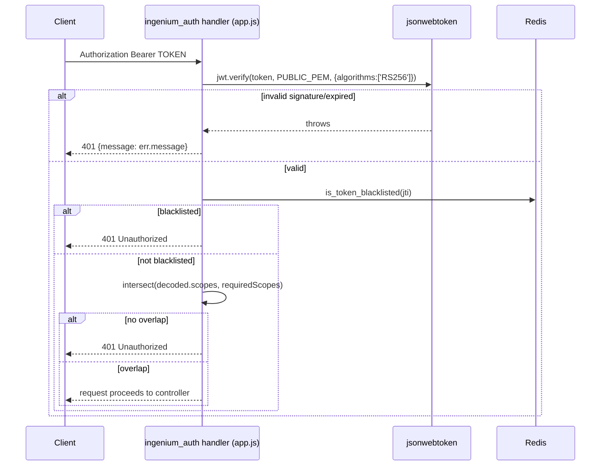

# Security & Error Handling

[← Back to Home](./README.md) · [Architecture](./Architecture.md) · [Core Components](./Core-Components.md) · [API Reference](./Api-Reference.md)

This page documents the security mechanisms **as implemented**. It does not claim the service is secure in any general sense — only what exists in the code is described.

## Authentication mechanisms

Three distinct credential-verification paths exist, all reached through the `basicAuth` security handler in `auth_service/app.js` (used only by `GET /login`):

| Method | Selected by | Implementation | Notes |
|---|---|---|---|
| Configured test user | `USERNAME`/`PASSWORD` env vars match the supplied Basic-Auth credentials | Inline check in `app.js`, no LDAP/RSA call | Documented in the root README as the account for automated/local testing; bypasses `AUTH_METHOD` entirely if both env vars are set and match |
| LDAP bind | `AUTH_METHOD=password` (default) or `X-AUTH-METHOD: password` header | `authenticate.js#ldap_authenticate` — binds as `uid=<user>,ou=personnel,<env_config.ldap_base_dn>` using the supplied password | TLS options are hard-coded to `minVersion/maxVersion: TLSv1` and `ciphers: DEFAULT@SECLEVEL=0` (`env_config.ldap_tls_options`) — this is a deliberately weakened TLS policy, presumably for compatibility with the target LDAP server; the repository does not document why |
| RSA SecurID MFA | `AUTH_METHOD=rsa` or `X-AUTH-METHOD: rsa` header | `authenticate.js#rsa_authenticate` — two-step `POST {RSA_URL}/initialize` then `POST {RSA_URL}/verify` with the passcode, via `axios` | Success requires `attemptResponseCode === 'SUCCESS'` in the verify response |

If `X-AUTH-METHOD` doesn't match the server's configured `AUTH_METHOD`, `app.js` rejects the request with a `401` before calling either authenticator (`Unauthenticated: auth service is configured for ${AUTH_METHOD}. ${authMethod} is not supported.`).

**Authentication only produces a session if the user also has at least one effective permission.** `AuthenticationService.login` calls `login_helper.getPermission` after successful authentication and returns `401 Unauthorized` if the resolved `scopes` array is empty — see [Architecture → RBAC resolution](./Architecture.md#rbac-resolution-how-a-users-effective-permissions-are-computed).

## Token issuance & verification (JWT)

- **Algorithm:** `RS256` exclusively — both signing (`jwt_helper.js#encode_token`, using `PRIVATE_PEM`) and verification (`app.js`'s `ingenium_auth` handler and `jwt_helper.js#decode_jwt`, using `PUBLIC_PEM`) pin `algorithms: ['RS256']`. This prevents the classic `alg: none`/HS256-confusion downgrade attack, **provided `PUBLIC_PEM` is only ever used for verification and never accidentally accepted as an HMAC secret** — which the pinned `algorithms` array enforces.
- **Claims:** `username`, `scopes` (array of `{scope, venue_group_id}`), `roles` (array of `{role, venue_group_id}`), `jti` (UUID v4, unique per token), `iat` (backdated by `TEN_SEC_OFFSET`=10s for clock-skew tolerance), `oit` ("original issued time" — preserved across refreshes).
- **Lifetime:** `ACCESS_TOKEN_TIMEOUT = '3410s'` (~56.8 minutes) per token; `LONG_EXPIRE` (default 43200s/12h) bounds how long a chain of refreshes may extend the *original* session, measured from `oit`.
- **Revocation (blacklist):** on `/logout`, `AuthenticationService.logout` writes the token's `jti` into Redis with a TTL equal to `ACCESS_TOKEN_TIMEOUT` (`redisClient.expire(jti, ms(ACCESS_TOKEN_TIMEOUT)/1000)`). The `ingenium_auth` security handler checks `jwtHelper.is_token_blacklisted(jti)` (a Redis `GET`) on **every** authenticated request. `jwt_helper.refresh_token` also checks the blacklist before minting a renewed token with the same `jti`.
- **Scope enforcement:** the `ingenium_auth` handler intersects the decoded token's scope names against the scopes the matched Swagger operation requires (`_.intersection(scope_names, scopesOrApiKey)`); any non-empty intersection grants access — scopes are **not** required to be a superset, just to overlap by at least one entry.
- **Bug — the documented `403` "long expire" response on `/refresh_token` is unreachable.** `jwt_helper.js#refresh_token` returns `{access_token: "error"}` when the `LONG_EXPIRE` window has elapsed (`auth_service/api/helpers/jwt_helper.js`, the final `else` branch). But `AuthenticationService.refresh_token` (`auth_service/api/controllers/AuthenticationService.js`) checks `new_token.token == "error"` — a property that does not exist on that object (it should check `new_token.access_token`). Because `new_token.token` is always `undefined`, this condition never matches, so execution falls through to the success branch and responds `200 {"access_token": "error", "access_token_timeout": undefined}` instead of the documented `403`. The unit test for this path (`auth_service/tests/unit/AuthenticationService.test.js`, `"responds 403 when refresh returns a token error marker"`) mocks `jwtHelper.refresh_token` to resolve `{token: 'error'}` — a shape that does not match what `jwt_helper.js` actually returns (verified separately by `auth_service/tests/unit/jwt_helper.test.js`, which asserts `{access_token: 'error'}`) — which is why 100% coverage does not catch this. See [Extending & Troubleshooting](./Extending-And-Troubleshooting.md) for this listed as a known gap.



## Authorization model (scopes)

`swagger.yaml`'s `ingenium_auth` OAuth2 (implicit-flow, in name only — there is no actual OAuth2 authorization-code exchange implemented; it is used purely as a container for scope strings) security definition enumerates: `admin`, `execute:wsts`, `execute:testbed`, `execute:sit`, `execute:other`, `config_mgmt`, `redline`, `author`, `basic`. The seeded `Permissions` table (`server/migrations/20170221201539-permissions.js`) additionally contains `imcm` and `test_lead`, which are **not** declared as scopes on any Swagger operation — a user can be granted these permission names, and they will appear in their JWT/`scopes` field and in `/users` API responses, but no endpoint currently requires them, so they cannot by themselves unlock any route.

The **default** security requirement (`admin` scope via `ingenium_auth`) applies to essentially all RBAC management endpoints (`/roles*`, `/permissions*`, `/users*`, `/groups*`, `/logging`) unless a route overrides it. Only `basic`-scoped and unauthenticated routes deviate — see [API Reference → Authorization defaults](./Api-Reference.md#authorization-defaults) for the full per-route table.

## Secrets handling

| Secret | Where it lives | Notes |
|---|---|---|
| `PRIVATE_PEM` (JWT signing key) | Environment variable | Never logged; only read by `jwt_helper.js`. Root README instructs developers to generate their own for local dev. |
| `PUBLIC_PEM` (JWT verification key) | Environment variable | Not sensitive by design, but must be supplied directly — there is no orchestration file that provisions it for you (see [Configuration](./Configuration.md#how-environment-variables-are-supplied)). |
| MySQL root password | `MYSQL_ROOT_PASSWORD` env var (runtime) / hard-coded `pwpwpw` in `server/config.json` (Sequelize CLI only) | `server/config.json` is only used by the Sequelize CLI, not the running app — see [Configuration](./Configuration.md#database-connection-config-auth_serviceserverconfigjson-and-sequelizerc). The hard-coded CLI password should not be assumed to match the runtime credential. |
| RSA MFA client key | `RSA_CLIENT_KEY` env var | Sent as the `client-key` header to `RSA_URL`. |
| `.env` file (if used to pass `--env-file` to `docker run`) | Git-ignored (`.gitignore`: `.env`, `secret.*`, `private.pem`) | Not committed; this is the correct pattern, but there is no `.env.example`/`.env.sample` file in the repository to show the expected shape — new developers must reconstruct it from the README and `env_config.js`. |

## Input validation

- **Schema validation:** the `_swagger_validate` bagpipes fitting validates both requests and responses against `swagger.yaml`'s schemas (`validateResponse: true`), rejecting malformed bodies/params before a controller ever runs.
- **LDAP-backed existence checks:** before attaching a user/group to a role, `RoleService.js` always validates the name against LDAP first (`ldap_helper.validate_user_exists`/`validate_users_exist`/`validate_ldap_group_exists`/`validate_ldap_groups_exist`) — arbitrary usernames/group names cannot be injected into the RBAC tables through the role-editing endpoints. The one documented exception is the configured test user, which `validate_users_and_groups` special-cases so it's never rejected by the LDAP check.
- **SQL injection surface:** all database access goes through Sequelize's query builder (`where: {...}`, `$like`, `$in`) — no raw SQL string interpolation was found in the services/helpers reviewed.

## Error-handling conventions

Every service function in `api/controllers/*Service.js` follows the same shape:

```js
somePromiseChain()
  .then(function (result) { res.status(200).json(result); })
  .catch(function (err) {
    let msg = "<function> couldn't perform action, <cause>";
    log.critical(msg, util.inspect(err));   // or log.error / log.debug depending on severity
    res.status(500).json({ message: msg }); // or 400/404 depending on the failure kind
  });
```

- **`404`** — the requested entity (role/user/group/permission) does not exist; logged at `debug`.
- **`400`** — malformed input, e.g. a `create_role` call missing `name`, or a Sequelize `ValidationError`; logged at `debug` or `error`.
- **`401`/`403`** — authentication/authorization failures, produced by the security handlers in `app.js`, not by the services.
- **`500`** — unexpected failures (a Sequelize call rejects for a reason other than validation); logged at `critical` or `error` and `util.inspect(err)` is included in the log line (never in the HTTP response body, which only ever contains `{"message": "..."}"`, matching `#/definitions/ErrorResponse` in `swagger.yaml`).
- **Logging levels** (`node_funcs.js`, custom Winston levels): `critical`, `error`, `warning`, `info`, `debug`, `trace` (in decreasing severity/increasing verbosity — note this is the reverse of Winston's own numeric convention, and is why the custom `custom_log_levels` map is defined explicitly rather than using Winston's defaults). The response-logging interceptor in `app.js` uses `log.error` for any response with `status < 200 || status >= 400`, and `log.info` otherwise.
- **No global Express error-handling middleware** exists (no `app.use((err, req, res, next) => ...)`); the bagpipes pipe's `onError: json_error_handler` fitting handles routing-level errors (e.g. security-handler rejections), while business-logic errors are handled per-function as shown above.
- **No retry logic** exists for LDAP/RSA/Redis calls at the service layer — a failed LDAP search rejects immediately and surfaces as a `500`/`404` to the caller. The one exception is `server/models/index.js#init_db`, which retries the *initial database connection* up to 10 times at boot (see [Core Components](./Core-Components.md#bootstrap-auth_serviceappjs)).

## Cross-references

- [Architecture](./Architecture.md) — the request/login sequence diagrams these mechanisms plug into.
- [Core Components](./Core-Components.md) — full function-level detail for `jwt_helper.js`, `ldap_helper.js`, `authenticate.js`, `login_helper.js`.
- [Configuration](./Configuration.md) — every security-relevant environment variable.
- [Extending & Troubleshooting](./Extending-And-Troubleshooting.md) — known gaps (e.g. unreachable endpoints, the weakened LDAP TLS policy) to be aware of before extending this surface.
